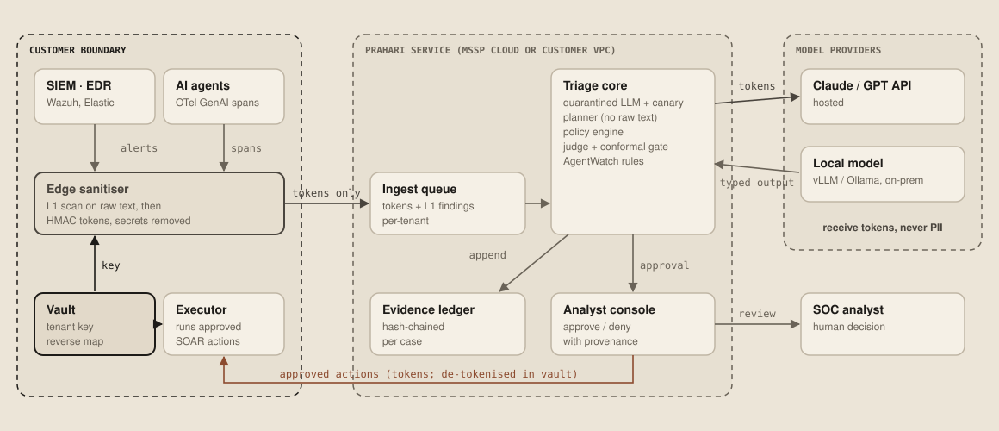

# Prahari

**An agentic SOC copilot that cannot be talked out of an alert.**

Prahari (प्रहरी, "sentinel") triages security alerts with LLM agents. It is built on one assumption: every log line, email and tool output it reads may have been written by the attacker.

> CyberForge 2026 (Mitigata × HackCulture). Theme: *Innovative Solution for AI & Cybersecurity*. Tracks: **AI-Assisted Security Operations** and **AI Security**.

---

## The problem

AI SOC agents are moving from pilot to production. They have two documented failure modes:

1. **They get steered by the logs they read.** Attackers plant instructions in user-agents, usernames, command lines and emails. In LogInject (arXiv:2607.14493), these payloads hijack LLM log analysis up to **88.2%** of the time. Layered filters still leave **8.4%** getting through. Sygnia showed an XDR's AI summary repeating the attacker's own cover story. A fully automated SOC "would have closed the ticket".
2. **They dismiss real attacks when the evidence is missing.** On ALERT-BENCH (arXiv:2610.10608, Oct 2026), every baseline triage agent missed **at least 40.4%** of attack alerts. The most common cause was treating an empty search as proof of "benign". Clearing the logs produces exactly that result.

Meanwhile, the volume keeps growing. CERT-In handled **2.94 million** incidents in 2025, up 44% on 2024. About **28–40%** of SOC alerts are never investigated. In surveys, **0%** of organisations allow AI full autonomy, because nobody can bound how often it will be wrong. MSSPs that send customer logs to cloud LLMs also have a DPDP Act problem.

## What Prahari does

Five planes. Each is a published 2025–26 result or production pattern, re-engineered for a multi-tenant SOC:

| Plane | What it guarantees | Built on |
|---|---|---|
| **Privacy** | No model ever sees a raw identifier or secret. Tenant-keyed HMAC tokens keep correlation intact ("one user, three hosts", "same /24"). | SOC Prime LogTotal sanitizer (2026), DPDP Rules 2025 |
| **Provenance** | Attacker-controlled text can change what the model *says*, never what the SOC *does*. Every value carries taint, and a deterministic policy engine gates each action. | CaMeL (DeepMind, 2503.18813), FIDES (Microsoft, 2505.23643), Progent (2504.11703), Meta *Agents Rule of Two* |
| **Detection** | Injection attempts are caught and turned into a **signal**: an alert that tries to talk the SOC out of itself gets a higher score. | Prompt Guard 2 / LlamaFirewall (2505.03574), known-answer canaries (DataSentinel, 2504.11358), TaskTracker (2406.00799) |
| **Investigation** | No benign verdict while an attack hypothesis is open. An empty search counts as a coverage gap, never as evidence. Every step goes into a hash-chained, tamper-evident ledger. | AIDA / ALERT-BENCH (2610.10608) |
| **Assurance** | Auto-close only below a **conformal threshold**, so at most α (e.g. 1%) of real attacks can ever be auto-closed. This holds even when the model is badly calibrated. | Split conformal prediction (distribution-free) |

Plus **AgentWatch**, which runs the same taint logic on the customer's own AI agents. Prahari ingests OpenTelemetry GenAI traces (`gen_ai.*`) and raises an alert when a tool call is steered by content the agent *read* instead of what the user *asked*. The alerts are mapped to OWASP ASI01/ASI02 and MITRE ATLAS and land in the same SOC queue.



*Raw telemetry is scanned and tokenised inside the customer's network. Prahari and every model only see tokens. Actions return through the customer's own executor.*


More diagrams (taint flow, policy engine, privacy, judge and ledger, conformal gate, AgentWatch, correlation) are in [docs/architecture.md](docs/architecture.md). They are generated by [`docs/diagrams/diagrams.py`](docs/diagrams/diagrams.py).

Full design: [docs/architecture.md](docs/architecture.md). Threats: [docs/threat-model.md](docs/threat-model.md). Research basis: [docs/research-basis.md](docs/research-basis.md). Hackathon-day build plan: [docs/build-plan.md](docs/build-plan.md). Third-party disclosure: [DISCLOSURES.md](DISCLOSURES.md).

## Run it

Python 3.10+, no dependencies for the core.

```bash
pip install -e ".[dev]"
python -m prahari.demo      # end-to-end on examples/
pytest -q                   # 26 tests
```

The demo walks through six scenes:

1. The calibrated conformal gate.
2. What the model sees after pseudonymisation.
3. Triage of a six-alert storm, including an alert carrying a log-borne injection.
4. A fooled planner trying to allowlist the attacker's IP and being sent to a human.
5. Correlation into a three-stage kill chain on tokens only.
6. AgentWatch catching an injection-driven `send_email` in an AI support agent.

## Status

| Component | State |
|---|---|
| Provenance labels, policy engine, conformal gate, privacy plane, ledger, judge, correlation, AgentWatch, canaries | Working, tested (`src/prahari/`) |
| LLM-backed quarantined extractor and planner (Claude / GPT / local) | Interfaces defined; built on hackathon day |
| Prompt Guard 2 as detection layer 2 | Optional extra (`.[ml]`), hackathon day |
| Wazuh connector, analyst console (approve/deny), GUIDE-dataset calibration | Hackathon day ([build plan](docs/build-plan.md)) |

Calibration numbers in the demo are **synthetic and seeded**. On hackathon day they are replaced with scores computed on Microsoft's GUIDE triage dataset (1.6M alerts labelled TP/BP/FP).

## Team Zenith

Two-person team (CyberForge rule). Vishnu Kosuri: GSEC, GCIH, CEH v13; 1st place OWASP AppSec Bangalore CTF; 1st place SANS NetWars. Teammate: `[name]`.

## License

Apache-2.0
